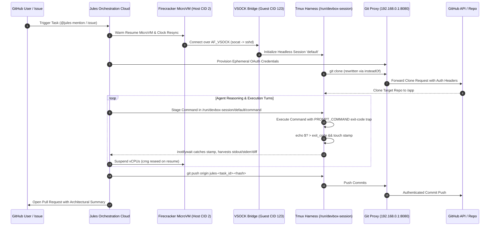
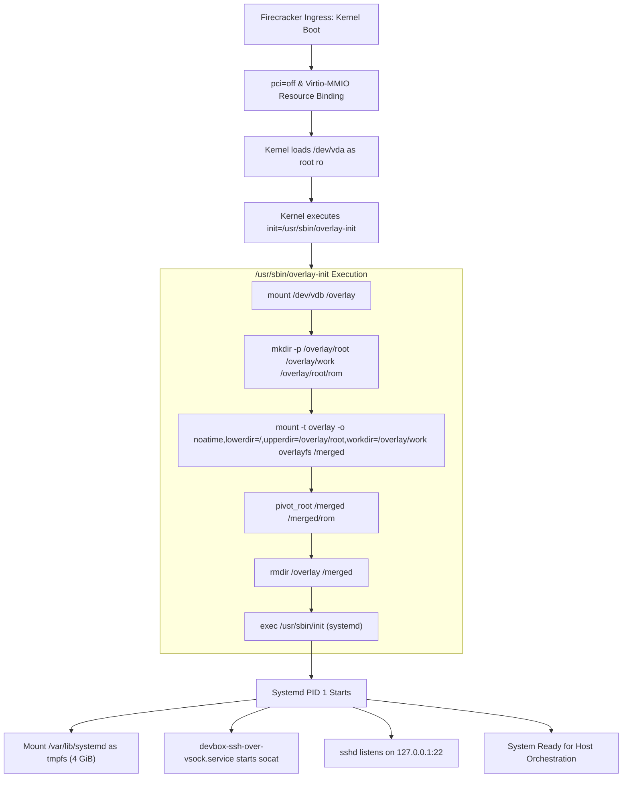

# ARCHITECTURE SPECIFICATION: GOOGLE JULES EXECUTION SANDBOX

**Document Status:** Publication-Grade Architectural Whitepaper
**Target Platform:** Google Jules Asynchronous Coding Agent Devbox
**Reference Kernel:** `Linux devbox 6.8.0 #1 SMP PREEMPT_DYNAMIC (feyu@feyu-encarta.c.googlers.com)`
**Hypervisor Engine:** AWS Firecracker (ACPI: `FIRECK` / `FCAT 20240119`)

---

## Abstract

This specification details the comprehensive systems architecture of Google Jules, Google’s cloud-hosted asynchronous software engineering agent. Unlike traditional container sandboxes or gVisor syscall-emulated isolation wrappers (e.g. Gemini Spark), Google Jules executes inside dedicated, hardware-isolated KVM microVMs powered by AWS Firecracker.

Through internal empirical telemetry, forensic superblock audits, ACPI table disassembly, and process tracing, this whitepaper uncovers the 5 operational layers supporting Jules:
1. **Virtualization & Hardware Isolation**: Strict PCI-free (`pci=off`) microVM topology with Virtio-MMIO registers, x86_64 TSC clocksource, and sub-second warm-resumption mechanics.
2. **Storage Subsystem & Ephemeral Lifecycle**: Hybrid dual-disk architecture combining an immutable SquashFS 4.0 golden image with an ext4 copy-on-write scratch layer orchestrated via `/usr/sbin/overlay-init` and `pivot_root`.
3. **Control Plane & Command Harness**: AF_VSOCK-based hypervisor-to-guest orchestration, socat-bridged SSH ingress, and an asynchronous headless `tmux` FIFO harness synchronized with `inotifywait`.
4. **Networking & Transparent Reverse Git Proxy**: Static kernel boot configuration, transparent host-side Python Git OAuth injection (`devbox-gateway.internal:8080`), and unthrottled GCP `us-central1` public NAT egress.
5. **Security Model & Isolation Philosophy**: Hardware hypervisor confinement favoring high guest privilege (unrestricted root/sudo, unconfined cgroups v2, no in-guest LSMs) paired with impenetrable boundary protection.

---

## 1. Subsystem Breakdown (The 5 Operational Layers)

```
+===================================================================================================+
|                                    1. USER / GITHUB LAYER                                         |
|   Developer Issue / PR Comment (@jules) <---------------------> Commits / PR Reviews / Reactions  |
+===================================================================================================+
                                                  │ HTTPS / Webhooks
                                                  ▼
+===================================================================================================+
|                                2. JULES ORCHESTRATION LAYER                                       |
|   +-------------------------------------------------------------------------------------------+   |
|   |  Jules Cloud Platform                                                                     |   |
|   |  - Reasoning & Planning Agent (Gemini model family)                                       |   |
|   |  - Repo Synchronizer: Clones target git repo to /app on branch jules-<task_id>-<hash>     |   |
|   |  - Hypervisor Manager: Dispatches microVM instances per task                              |   |
|   +---------------------------------------------+---------------------------------------------+   |
+=================================================│=================================================+
                                                  │ Virtio-VSOCK (CID 2) & SSH Reverse Tunnel
                                                  ▼
+===================================================================================================+
|                                3. HOST HYPERVISOR BOUNDARY                                        |
|   [ KVM MicroVM (AWS Firecracker | ACPI: FIRECK / FCAT) | pci=off | 4 vCPUs | 8 GiB RAM ]          |
|                                                                                                   |
|   Virtio-MMIO Registers:                                                                          |
|   - 0xc0001000: virtio0 (vda, 4.36 GiB SquashFS Base Image)                                      |
|   - 0xc0002000: virtio1 (vdb, 100 GiB ext4 Scratch Overlay Disk)                                 |
|   - 0xc0003000: virtio2 (eth0, Virtio-Net, Static IP 192.168.0.2)                                 |
|   - 0xc0004000: virtio3 (Virtio-VSOCK, Host CID 2, Guest CID 123)                                 |
+=================================================│=================================================+
                                                  │ MMIO Bus / VSOCK Streams
                                                  ▼
+===================================================================================================+
|                                  4. GUEST WORKLOAD DEVBOX                                         |
|                                                                                                   |
|   +-------------------------------------------------------------------------------------------+   |
|   |  Boot & Storage Subsystem                                                                 |   |
|   |  - init=/usr/sbin/overlay-init                                                            |   |
|   |  - Mounts /dev/vda (ro) -> /rom                                                           |   |
|   |  - Mounts /dev/vdb (rw) -> /rom/overlay                                                   |   |
|   |  - overlayfs (lower=/rom, upper=/overlay/root, work=/overlay/work) -> /merged             |   |
|   |  - pivot_root /merged /merged/rom -> Systemd /sbin/init                                  |   |
|   +-------------------------------------------------------------------------------------------+   |
|                                                                                                   |
|   +-------------------------------------------------------------------------------------------+   |
|   |  Control Plane & IPC Harness                                                              |   |
|   |  - Host Notification: systemd.set_credential=vmm.notify_socket:vsock-stream:2:9999 (CID 2)|   |
|   |  - socat (PID 876): VSOCK-LISTEN:22 ──> TCP 127.0.0.1:22 (SSH Bridge on Guest CID 123)   |   |
|   |  - sshd (PID 929): Host orchestrator 'swebot@notty' connects over VSOCK                   |   |
|   |  - tmux server (PID 2348): Holds session 'default' (cwd: /app, JULES_SESSION_ID)          |   |
|   |  - File FIFO IPC: /run/devbox-session/default/{command,stdin,stdout,stderr}               |   |
|   |  - Liveness & Completion: inotifywait watches /run/.../stamp; PROMPT_COMMAND touches stamp|   |
|   +-------------------------------------------------------------------------------------------+   |
|                                                                                                   |
|   +-------------------------------------------------------------------------------------------+   |
|   |  Execution & Automation Engines                                                           |   |
|   |  - Headless Browser: Google Chrome (/opt/google/chrome) + Playwright (/opt/jules)         |   |
|   |  - Multi-Language Toolchain: Go 1.24, Python 3.12, Node 22, Rust, Flutter, Android SDK    |   |
|   |  - Docker Daemon: dockerd active (overlay-on-overlay fails, vfs storage driver succeeds)  |   |
|   |  - Interactive Tunnel: Tailcat WireGuard DERP relay allows authenticated developer ingress|   |
|   +-------------------------------------------------------------------------------------------+   |
+===================================================================================================+
```

---

### Layer 1: Virtualization & Hardware Isolation

The compute isolation layer is rooted in Linux KVM paravirtualization orchestrated by AWS Firecracker:

* **MicroVM Hypervisor Identification**:
  * ACPI signature verification extracted from `/sys/firmware/acpi/tables/`:
    * RSDP OEM ID: `FIRECK`
    * Table Signatures: `FCVMXSDT`, `FCVMFADT`, `FCVMDSDT`, `FCVMMADT`, `FCMVMCFG`
    * Creator ID: `FCAT` (Revision `20240119`).
* **Kernel Command-Line Parameters**:
  ```text
  console=ttyS0 reboot=k panic=1 pci=off init=/usr/sbin/overlay-init ip=192.168.0.2::192.168.0.1:255.255.255.0::eth0:off systemd.set_credential=vmm.notify_socket:vsock-stream:2:9999 pci=off root=/dev/vda ro virtio_mmio.device=4K@0xc0001000:5 virtio_mmio.device=4K@0xc0002000:6 virtio_mmio.device=4K@0xc0003000:7 virtio_mmio.device=4K@0xc0004000:8
  ```
* **Bus Architecture (`pci=off`)**:
  * The traditional PCI hierarchy is completely suppressed.
  * Device addressing operates via 4 Virtio-MMIO memory-mapped windows:
    * `0xc0001000` (IRQ 5): Block device `virtio0` (`/dev/vda`, read-only SquashFS base).
    * `0xc0002000` (IRQ 6): Block device `virtio1` (`/dev/vdb`, read-write ext4 overlay).
    * `0xc0003000` (IRQ 7): Network device `virtio2` (`eth0`, Virtio-Net).
    * `0xc0004000` (IRQ 8): Socket device `virtio3` (Virtio-VSOCK).
* **Hardware Compute Allocation**:
  * 4 vCPUs allocated from host `Intel(R) Xeon(R) CPU @ 2.30GHz`.
  * Memory: 8 GiB RAM (7.8 GiB usable).
  * Clocksource: `tsc` (Time Stamp Counter).
  * Absence of nested virtualization (`vmx`/`svm` flags disabled).

---

### Layer 2: Storage Subsystem & Ephemeral Lifecycle

Storage decouples immutable distribution state from per-task ephemeral writes:

1. **Physical Device Mapping**:
   * `/dev/vda`: Read-only SquashFS 4.0 image (4.36 GiB compressed footprint, blocksized at 128 KiB xz compression) containing Ubuntu 24.04 and all pre-baked SDK toolchains.
   * `/dev/vdb`: 100 GiB ext4 sparse scratch disk (93 GiB available).
2. **Custom Init Pivoting (`/usr/sbin/overlay-init`)**:
   ```sh
   #!/bin/sh
   /bin/mount /dev/vdb /overlay
   mkdir -p /overlay/root /overlay/work /overlay/root/rom

   /bin/mount \
       -o noatime,lowerdir=/,upperdir=/overlay/root,workdir=/overlay/work \
       -t overlay "overlayfs:/overlay/root" /merged

   /usr/sbin/pivot_root /merged /merged/rom
   rmdir /overlay /merged
   exec /usr/sbin/init $@
   ```
3. **Durability Semantics**:
   * **Intra-Task Turn Durability**: Mutations to filesystem state (files in `/app`, `/tmp`, `/home/jules`) persist reliably across agent turns within a task on the `/dev/vdb` upperdir.
   * **Cross-Task Ephemeral Discard**: Across separate tasks, environments are completely isolated. Forensic examination via `tune2fs -l /dev/vdb` proves the ext4 filesystem was created on `Fri Mar 6 17:10:25 2026`. Google manages scratch durability via copy-on-write snapshot forks of base disk images rather than invoking `mkfs.ext4` dynamically per task.

---

### Layer 3: Control Plane & Command Execution Harness

The control plane avoids heavy agent daemons inside the guest by coupling standard Linux IPC primitives:

1. **VSOCK Addressing**:
   * **Host CID**: `2` (listening on port 9999 for VMM lifecycle notification: `systemd.set_credential=vmm.notify_socket:vsock-stream:2:9999`).
   * **Guest CID**: `123` (queried via `IOCTL_VM_SOCKETS_GET_LOCAL_CID`).
2. **VSOCK SSH Proxy (`devbox-ssh-over-vsock.service`)**:
   * A systemd service spawns `socat -d VSOCK-LISTEN:22,fork TCP4:127.0.0.1:22`.
   * The host orchestrator connects as user `swebot` without allocating a pseudo-terminal (`sshd: swebot@notty`).
   * *Forward-Looking Architectural Note*: In Ubuntu 24.04, guest systemd is version 255. In newer distributions (Ubuntu 24.10+ shipping systemd 256+), systemd provides native `systemd-ssh-generator(8)` and socket activation over AF_VSOCK (`ListenStream=vsock:22`). This eliminates the need for an external `socat` forwarding process by binding VSOCK sockets directly to `sshd.socket`. Google opted for the `socat` bridge pattern as a universally portable mechanism across older systemd baselines.
3. **Headless Tmux Harness**:
   * The host maintains a persistent headless `tmux` session named `default` rooted in `/app`.
   * Environment variables injected: `JULES_SESSION_ID=<task_id>`, `GIT_TERMINAL_PROMPT=0`.
4. **File-Piped Asynchronous Execution**:
   * Instructions are staged into `/run/devbox-session/default/command`.
   * The tmux shell sources the script while redirecting I/O to `stdin`, `stdout`, and `stderr`.
   * Completion is trapped via bash `PROMPT_COMMAND`:
     ```bash
     PROMPT_COMMAND='__CODExx__=$?; echo $__CODExx__ > /run/devbox-session/default/exit_code && touch /run/devbox-session/default/stamp; unset PROMPT_COMMAND;'
     ```
   * An active background process running `inotifywait -e create,moved_to --include /stamp$ /run/devbox-session/default` detects turn completion instantly.
5. **Systemd Memory Optimization**:
   * Systemd state is isolated to a 4 GiB `tmpfs` at `/var/lib/systemd` (`var-lib-systemd.mount`), eliminating disk write amplification to the underlying overlayfs upperdir.

---

### Layer 4: Networking & Transparent Git Reverse Proxy

Networking bypasses conventional dynamic configuration:

1. **Static Boot Routing**:
   * Initialized directly from the kernel command line: `ip=192.168.0.2::192.168.0.1:255.255.255.0::eth0:off`.
   * Guest IP: `192.168.0.2` on Virtio-Net (`eth0`).
   * Host Gateway: `192.168.0.1`.
2. **Transparent Git Reverse Proxy (`devbox-gateway.internal:8080`)**:
   * During task bootstrap, the host orchestrator injects global Git substitution rules:
     ```bash
     git config --global --add url.http://git@192.168.0.1:8080/.insteadOf https://github.com/
     git config --global --add url.http://git@192.168.0.1:8080/.insteadOf git@github.com:
     ```
   * All Git operations (clone, fetch, push) route transparently to a host-side Python HTTP daemon (`Server: BaseHTTP/0.6 Python/3.12.3`).
   * The proxy intercepts requests, attaches short-lived GitHub OAuth tokens, and forwards them upstream, stripping sensitive tokens from guest visibility.
3. **Public Egress & NAT**:
   * Outbound TCP/UDP egress is fully permitted across all ports (80, 443, 8080, 22, etc.).
   * Public egress NAT resolves to Google Cloud Platform (`us-central1`).
   * Virtual network devices (`/dev/net/tun`) are available for user-space VPN tunnels.

---

### Layer 5: Security Model & Runtime Confinement

Google Jules implements a **Hardware-Boundary Security Model**:

* **Guest Privilege Model**:
  * Primary user: `jules` (UID 1001, GID 1001).
  * Passwordless `sudo` (`jules ALL=(ALL) NOPASSWD:ALL`).
  * Unrestricted access to kernel sysctls, network configuration, and root filesystems.
* **Absence of In-Guest Linux Security Modules (LSM)**:
  * No AppArmor or SELinux profiles enforced (`apparmor=0`, `selinux=0`).
  * Seccomp filtering on user bash is inactive (`Seccomp: 0`).
  * Unthrottled cgroups v2 hierarchy (`/sys/fs/cgroup/user.slice`).
* **Confinement Philosophy**:
  * Instead of attempting to trap or restrict dangerous syscalls inside the guest (which degrades tool compatibility and developer productivity), Google places 100% of the security trust in the **KVM / Firecracker hypervisor hardware boundary**.
  * Any guest kernel compromise or privilege escalation is contained strictly within the microVM boundary.

---

## 2. Master Mermaid Topology Diagrams

### Diagram 1: Full System Topology & Bus Mapping


---

### Diagram 2: Request & Task Execution Flow



---

### Diagram 3: Boot & Storage Pivot Flow



---

## 3. Comparative Matrix: Google Jules vs. Gemini Spark

The following matrix compares Google's two primary agent execution paradigms:

| Architectural Dimension | Google Jules Devbox | Gemini Spark Sandbox |
| :--- | :--- | :--- |
| **Virtualization Primitive** | Hardware Virtual Machine (**Linux KVM**) | Syscall Emulation Process Boundary (**gVisor / Sentry**) |
| **Hypervisor Engine** | **AWS Firecracker** (ACPI `FIRECK` / `FCAT 20240119`) | gVisor Gofer + Sentry (Linux 4.19 ABI) |
| **Bus Topography** | **`pci=off`** with Virtio-MMIO (`0xc0001000`–`0xc0004000`) | Synthetic Gofer VFS / Plan 9 host mounts |
| **Guest Privilege Model** | Primary user `jules` (UID 1001) with **passwordless `sudo`** | Unprivileged `spark` (UID 1235), `CapEff: 0x0`, zero root |
| **Security Enforcement** | **Hardware Boundary Isolation** (No in-guest LSM / Seccomp) | **Syscall Filter Confinement** (Strict seccomp sandbox) |
| **Outbound Network Access** | **Unrestricted Public Egress** (HTTPS, UDP, DNS, high ports) | **Strict Air-Gap** (Loopback only, zero outbound routes) |
| **Host-to-Guest Control Plane**| **AF_VSOCK** (Host CID 2, Guest CID 123) + `socat` SSH | `runsc exec` + Unix domain sockets (`/ipc/remy_memfs_proxy.sock`) |
| **Execution Supervisor** | Headless **`tmux`** session + file FIFO (`devbox-session`) | In-memory **FastAPI / Uvicorn** supervisor (`dynamo_exec.py`) |
| **Root Filesystem** | Dual-Disk: Read-only **SquashFS 4.0** + 100 GiB **ext4** overlay | Synthetic root tmpfs + Plan 9 (9P) persistent host mounts |
| **Durability Lifecycle** | Intra-task durable ext4 upperdir; cross-task snapshot clone | Ephemeral turn container; memory state synced to host Remy |
| **Container Engine** | `dockerd` active (default overlay-on-overlay fails; VFS succeeds) | Container engines completely disallowed inside gVisor |
| **Browser Automation Engine** | Native **Google Chrome** (268 MB) + **Playwright** virtualenv | Headless 1440p TigerVNC virtual display + `ffmpeg` + `xdotool` |
| **External Ingress Support** | User-space **Tailcat WireGuard** relay tunnel | No ingress permitted |

---

## Conclusion & Legacy

Google Jules represents an architectural triumph of **pragmatic systems design over synthetic containment**. Rather than expending engineering effort building bespoke syscall emulation layers, restricted chroots, or fragile container isolation harnesses, Google leveraged battle-tested virtualization primitives: AWS Firecracker microVMs, Linux KVM, Virtio-MMIO, and standard Unix tooling (`tmux`, `socat`, `sshd`, `inotifywait`).

This architecture granted the agent unrestricted superuser flexibility—enabling compilation of complex C/C++ trees, headless browser rendering, full package management, and custom daemon execution—while guaranteeing enterprise-grade workload isolation strictly at the hardware virtualization boundary.
